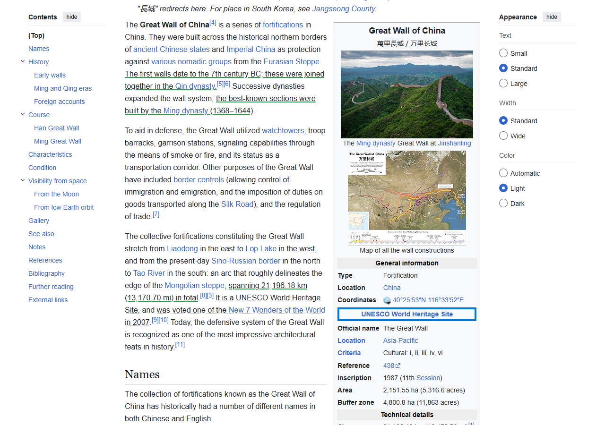
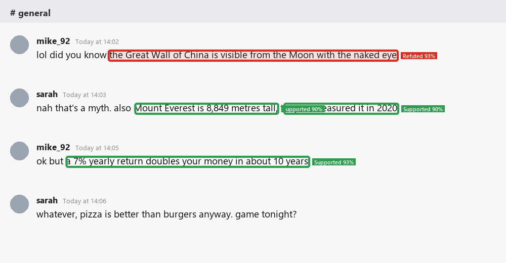
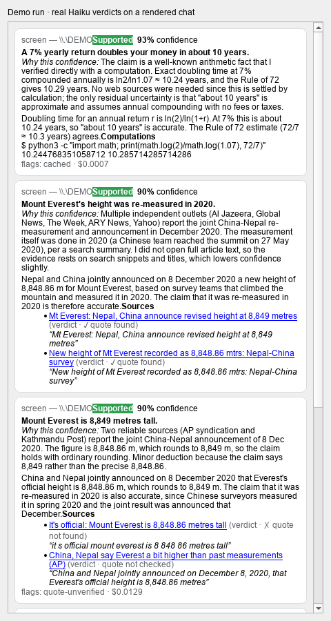
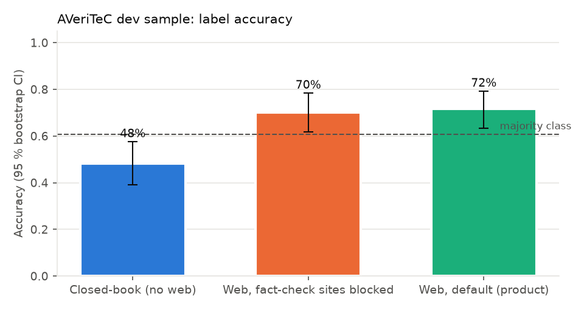
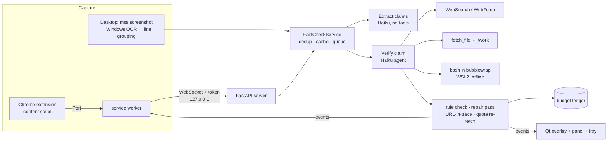
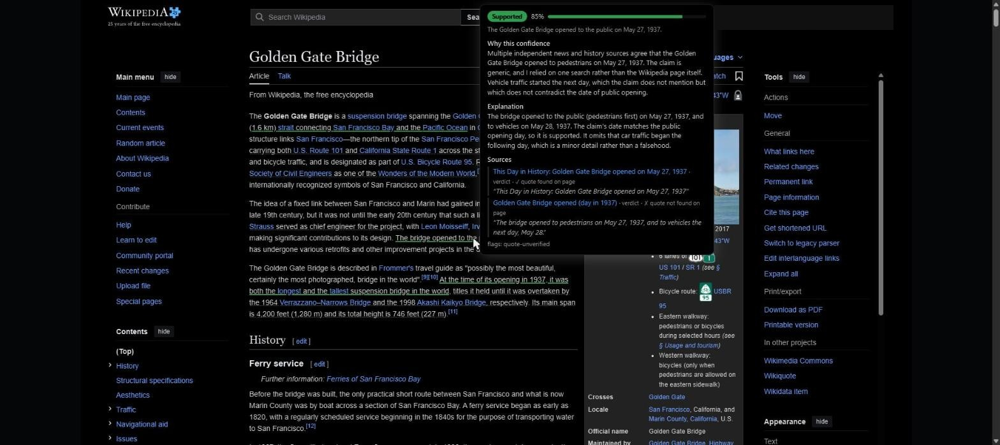

# auto-fact-checker-of-websites-apps

**Fact-check the claims you see — in Chrome and in any desktop app (Discord, Slack, PDFs, ...).**
A Chrome extension underlines claims inline on web pages; for everything else, Windows OCR reads the
screen and a click-through overlay boxes each claim. Every claim is checked by a
[Claude Agent SDK](https://code.claude.com/docs/en/agent-sdk/overview.md) agent running **Haiku 5.5** with web search, page fetch, an audited
file-download tool and a **sandboxed bash shell** (python/numpy/pandas/sympy, node, deno, gcc, … inside
bubblewrap in WSL2). Each verdict carries one of the four [AVeriTeC](https://arxiv.org/abs/2305.13117) labels, a **confidence score with the
reasoning for that confidence**, sources with quote checks, and — for false or cherry-picked claims — a
**sourced correction**.

| Browser (extension, real Haiku verdicts on a live page) | Desktop (overlay on a rendered chat, real Haiku verdicts) |
|---|---|
|  |  |



**Why:** misinformation reaches people wherever they read, not only on web pages. Existing tools
(e.g. [OpenErrata](https://github.com/ZeroPathAI/OpenErrata), [Loki](https://arxiv.org/abs/2410.01794)) cover the browser or a text box; none we found reads arbitrary desktop apps
with an on-screen overlay ([literature review](reports/literature-review.md)).

**Method in one line:** captured text → Haiku extracts atomic, self-contained, check-worthy claims (the
decomposition idea of [SAFE](https://arxiv.org/abs/2403.18802)) → one Haiku agent per claim gathers evidence with tools and returns a
schema-enforced verdict → our code checks the verdict rules, that cited URLs appeared in the agent's own
results, and that quotes really appear on the cited pages.

## Results (preregistered evaluation)

Benchmarks: [AVeriTeC](https://arxiv.org/abs/2305.13117) dev claims (real-world fact-checked claims, 4 labels) and [CLEF CheckThat! 2024](https://checkthat.gitlab.io/clef2024/task1) Task 1
(check-worthiness). Hypotheses, metrics, sample sizes and decision rules were frozen in
[`reports/preregistration.md`](reports/preregistration.md) (git tag `prereg-v1`) before any confirmatory run. The whole project ran
on a $10 API-equivalent budget, which limited the web-search comparisons to 120 claims (minimum detectable effect
13.5–17.5 accuracy points), so small effects show up as "inconclusive", not as "no effect".

<!-- GEN:readme_results -->
* **H1 — Web tools (fact-check sites blocked) vs answering from memory:** +21.7 accuracy points (95 % CI +11.7 to +30.8; n = 120; Holm-adjusted p < 0.001) → **supported**.
* **H2 — Allowing existing fact-check sites vs blocking them:** +1.7 accuracy points (95 % CI -5.8 to +9.2; n = 120; Holm-adjusted p = 0.412) → not supported (inconclusive at this sample size).
* **H3 — Reading the claim through rendering + Windows OCR vs exact text:** +0.8 points (one-sided 95 % lower bound -2.0; margin −3; n = 500; mean OCR character error rate 1.09 %) → **non-inferior**.
* **H4 — Finding check-worthy sentences (CheckThat! 2024):** F1 0.759 vs best simple baseline 0.424 (Holm-adjusted p < 0.001) → **supported**.
* **Confidence calibration (product setting):** mean stated confidence 78.5 % vs accuracy 71.7 %; Brier 0.157, ECE 0.104.
* **Run-to-run variance (E2):** Fleiss' κ = 0.68 across 3 runs; same label in all runs for 68.0 % of claims.
* **Corrections (E3):** of 87 corrections, the judge found 45 consistent with the professional fact-check, 33 partially, 3 contradicting, and 6 where the professional verdict says the claim was true.
<!-- /GEN:readme_results -->

<!-- GEN:eval_table -->
| Role | System | Benchmark | Metric | Score |
|---|---|---|---|---|
| Baseline | Always 'Refuted' (majority class) | AVeriTeC dev sample (n = 120) | accuracy | 60.8 % |
| Baseline | Uniform random label | AVeriTeC dev sample | accuracy | 25.0 % (expected) |
| Control (no retrieval) | Closed-book (no web) | AVeriTeC dev sample | accuracy / macro-F1 | 48.3 % / 41.6 % |
| Ablation (no fact-check sites) | Web, fact-check sites blocked | AVeriTeC dev sample | accuracy / macro-F1 | 70.0 % / 53.0 % |
| **Method (product)** | Web, default (product) | AVeriTeC dev sample | accuracy / macro-F1 | 71.7 % / 50.9 % |
| Control (ideal capture) | Clean text → extract → closed-book verify | AVeriTeC dev (n = 500) | accuracy | 49.0 % |
| **Method (screen path)** | Rendered → OCR → extract → closed-book verify | AVeriTeC dev (n = 500) | accuracy | 49.8 % |
| **Method** | Product extractor | CheckThat! 2024 T1 EN test (n = 341) | F1 | 0.759 |
| Baseline | Number/quantity heuristic | CheckThat! 2024 T1 EN test | F1 | 0.424 |
| Baseline | All positive | CheckThat! 2024 T1 EN test | F1 | 0.410 |
| Control | Stratified random | CheckThat! 2024 T1 EN test | F1 | 0.256 |
<!-- /GEN:eval_table -->

In plainer words: see [`reports/summary.md`](reports/summary.md). Full reports: [retrieval vs memory](reports/exp-02-h1-h2-retrieval.md) ·
[OCR channel](reports/exp-03-h3-ocr.md) · [check-worthiness](reports/exp-04-h4-checkworthiness.md) ·
[variance](reports/exp-05-e2-variance.md) · [corrections](reports/exp-06-e3-corrections.md) · [paper](reports/paper/paper.pdf) ·
[interactive explorer](https://burnycoder.github.io/auto-fact-checker-of-websites-apps/) ·
per-claim results on Hugging Face: [dataset](https://huggingface.co/datasets/BurnyCoder/fact-check-what-you-see-results)
in the [collection](https://huggingface.co/collections/BurnyCoder/fact-checking-what-you-see-6af6bc948adcba118612a856).



---

## Features

* **Two capture paths**
  * Chrome/Chromium **MV3 extension**: exact page text, inline underlines via the CSS Custom Highlight API
    (no DOM edits), hover card with full verdict. Checks start only when you ask: toolbar button *Check this page
    now* or `Alt+Shift+F` (the visible page); *Check part of page…* or `Alt+Shift+S` (the paragraphs your selection
    touches, or, with nothing selected, a box you drag over the page; a checked selection is cleared, so the next
    press opens the box, and pressing it again closes the box); right-click "Fact-check selected text".
    Automatic checking while reading is an option.
  * **Desktop OCR** (Windows.Media.Ocr): `Ctrl+Alt+F` or the tray's *Check screen now* checks everything on all
    monitors, except windows it must not read (the app's own panel, blocked apps, private windows, and Chrome while
    the extension handles it), which are blacked out before OCR. `Ctrl+Alt+R` or *Check part of screen…* lets you
    drag a box, like Snipping Tool, and checks only that part ([picker](docs/images/region-picker.png)); Chrome
    inside the box is read too, since you picked it. The optional continuous mode checks the foreground window when
    it settles. Lines are grouped into messages/paragraphs before extraction.
* **Display**: per-monitor click-through **overlay** (colour = label, border width = confidence, tag "Refuted 93 %")
  and/or a **side panel** with label, confidence + reasoning, explanation, correction, sources (✓ quote found /
  ✗ not found / not checked), sandbox computations, and a "Check this claim" button for claims beyond the first
  3 that each check verifies automatically (`MAX_AUTO_CHECKS_PER_BATCH`). Screen boxes stay for 60 s after the last
  verdict arrives. The panel and the Chrome card, popup and Options page follow Windows / Chrome light and dark mode
  ([dark](docs/images/panel-dark-mode.png), [light](docs/images/panel-light-mode.png)).
* **Agent tools**: built-in WebSearch + WebFetch; `fetch_file` (raw CSV/JSON/XLSX/PDF/HTML into a per-claim `/work`
  folder, public internet only, SSRF-safe); `bash` in an offline bubblewrap sandbox with every interpreter/compiler
  in WSL.
* **Cost control**: hard project budget (default $20 API-equivalent; the evaluation ran under $10) in a committed [`budget_ledger.jsonl`](budget_ledger.jsonl),
  daily app cap, verdict cache, auto-check of only the first 3 new claims per batch, ≤ 2 web searches per claim.
* **Auth**: your Claude subscription login first; API key from `.env` only as automatic fallback.
* **Logging**: every prompt, tool call, tool output and result is written uncut to `logs/llm-*.jsonl` and the terminal.

## How it works



What happens when you run it:

1. `uv run factcheck` starts the Qt app (tray icon) and a background asyncio thread with the localhost server,
   the fact-check service and the capture loop.
2. When you press the toolbar button / `Alt+Shift+F` (Chrome) or `Ctrl+Alt+F` (desktop), text arrives from the
   extension (visible paragraphs of the page) or from OCR (all monitors). `Alt+Shift+S` / `Ctrl+Alt+R` send only the
   part you selected or dragged a box over. Optional automatic modes send it while you
   read (extension option; `FACTCHECK_MODE=continuous|both`: the foreground window, after two identical frames).
3. New blocks go to the **extractor** (one Haiku call, no tools) which returns atomic claims with exact spans.
4. Cached claims are answered immediately; the first 3 new ones are queued for **verification**, the rest wait
   for a click. Each verification runs in its own CLI subprocess with an isolated config, a fresh `/work` folder,
   hooks that cap searches, and a JSON schema for the verdict.
5. The verdict is validated (e.g. a "Refuted" verdict must include a correction with its own source); one cheap
   tool-less repair pass fixes rule violations; sources are checked against the tool trace and re-fetched to
   verify quotes.
6. Events flow back to the page (underline colour + hover card) or to the overlay and panel.

Details: [docs/architecture.md](docs/architecture.md) · security model: [docs/security.md](docs/security.md).

## Install

Requirements: Windows 11, [uv](https://docs.astral.sh/uv/), WSL2 with Ubuntu (for the sandbox; `bubblewrap` is
usually preinstalled — check with `wsl -e bwrap --version`), Google Chrome, and a Claude subscription logged in to
[Claude Code](https://code.claude.com/docs) (or an Anthropic API key).

```bash
git clone https://github.com/BurnyCoder/auto-fact-checker-of-websites-apps
cd auto-fact-checker-of-websites-apps
uv sync
wsl.exe -e bash scripts/setup_wsl_sandbox.sh
copy .env.example .env
```

* **Auth**: nothing to do if Claude Code is logged in with your subscription (`AUTH_MODE=auto` uses it).
  Optionally put `ANTHROPIC_API_KEY` in `.env` as a fallback. The subscription mode is meant for personal,
  single-user use; the SDK docs ask distributed products to use API keys
  ([legal](https://code.claude.com/docs/en/legal-and-compliance.md)).
* **Chrome extension** (needs the app running for the token):
  1. `uv run factcheck` — a blue check-mark icon appears in the Windows tray (maybe behind the `^` arrow).
  2. Right-click it → *Copy extension token*.
  3. In Chrome open `chrome://extensions`, switch on *Developer mode* (top right), click *Load unpacked* (top left)
     and select this repo's `extension/` folder. The card "Fact Check What You See" must show the ID
     `dkfijekfdkhfpkbidoifbdibdihhcgcp` (the local server only accepts that ID).
  4. On the card click *Details* → *Extension options*, paste the token (Ctrl+V) into *Extension token*, click *Save*;
     the status line should read "Connected to the local app ✓".
  5. Open an article and press `Alt+Shift+F` (or click the extension's toolbar button → *Check this page now*).
     Claims get a dotted underline; up to 3 of them (`MAX_AUTO_CHECKS_PER_BATCH`) turn green / red / amber / grey as
     verdicts arrive, the rest wait for *Check this claim* in the hover card. Nothing is sent before you ask, unless
     you tick *Check pages automatically* in Options. If the app is not running, a message says so.
  6. After updating `extension/` (e.g. `git pull`), click the reload arrow on the extension's card in
     `chrome://extensions`; reload open tabs, or just press the shortcut there (the extension re-attaches itself).
* **Budget:** `TOTAL_BUDGET_USD` (default 20) is one cap for everything recorded in `budget_ledger.jsonl`, including
  the development and benchmark spend of this repo. `DAILY_APP_BUDGET_USD`
  (default 10) caps the app per day, and each check first reserves its worst case ($0.21). When the cap is used up,
  the hover card says "Couldn't check: daily app budget … reached": raise the value in `.env` and restart the app.
  The default `FACTCHECK_MODE=hotkey` checks only when you press `Ctrl+Alt+F`; `continuous|both` check new text in
  every window you look at (chat apps included) and use the cap fastest.



## Use

```bash
uv run factcheck                                  # desktop app (tray, overlay, panel; Ctrl+Alt+F screen, Ctrl+Alt+R part)
uv run factcheck-cli claim "Water boils at 90 °C at sea level."
uv run factcheck-cli text "Paste a paragraph; every check-worthy claim in it is verified."
uv run factcheck-cli budget                       # API-equivalent spend so far
```

Settings live in `.env` (see [`.env.example`](.env.example)): `FACTCHECK_MODE=hotkey|continuous|both` (default hotkey),
`FACTCHECK_DISPLAY=overlay|panel|both`, `TOTAL_BUDGET_USD`, `DAILY_APP_BUDGET_USD`, `MAX_WEB_SEARCHES`,
`BLOCKED_APPS`, `HOTKEY` (whole screen), `REGION_HOTKEY` (drag a box), `FACTCHECK_FAKE_LLM=true` (deterministic fake
verdicts, $0, for UI work). Chrome shortcuts can be changed in `chrome://extensions/shortcuts`.
Tray menu: pause, check screen now, check part of screen, switch trigger/display modes, copy extension token, open
logs, budget.

## Privacy and safety (short version)

* Screen text is sent only to Anthropic (through the Agent SDK). Logs stay local and are gitignored.
* Not captured: blocked apps (password managers by default), our own windows, incognito/private windows, and Chrome
  windows while the extension handles them; the whole-screen check blacks them out before OCR wherever they are on
  top. Pause any time from the tray.
* Screen text is untrusted: the agent has no access to your files or shell. Its only code execution is an
  **offline** bubblewrap sandbox in WSL2 (no TCP/IP, AF_VSOCK blocked by seccomp, no Windows-exe interop) that sees
  nothing but `/usr`, a read-only tools folder and the claim's own `/work` folder; downloads go through our SSRF-safe `fetch_file`. Escape attempts are covered by tests
  (`tests/test_sandbox.py`, `tests/test_fetchfile_policy.py`).
* Your global Claude Code configuration (CLAUDE.md, hooks, skills, MCP servers, connectors) is not loaded into the
  agent.

## Tests

```bash
uv run pytest            # all $0: fake SDK/FakeRunner, real sandbox escape tests, real OCR, Playwright extension e2e
```

## Project layout

```
src/factcheck/
  app.py            # desktop entry point: config → logging → Qt → backend → UI
  cli.py            # factcheck-cli
  backend.py        # asyncio thread: uvicorn server + service + capture
  config.py log.py models.py
  pipeline/         # agent.py (SDK wrapper), extract.py, verify.py, prompts.py, sandbox.py, fetchfile.py,
                    # agent_tools.py, sources.py, cache.py, budget.py, service.py, policy.py, fake.py
  server/api.py     # localhost WebSocket for the extension
  capture/          # winapi.py, ocr.py, layout.py, watcher.py
  ui/               # overlay.py, panel.py, tray.py, hotkey.py, state.py
extension/          # Chrome MV3 extension (plain JS)
scripts/            # WSL sandbox setup, demo scripts
reports/            # literature review, preregistration, experiment reports, paper
tests/
```

## Technologies

Python 3.13 · [claude-agent-sdk](https://github.com/anthropics/claude-agent-sdk-python) 0.2.179 (Haiku 5.5) · PySide6 6.12 · FastAPI/uvicorn ·
[pywinrt](https://pypi.org/project/winrt-Windows.Media.Ocr/) Windows.Media.Ocr · mss · bubblewrap (WSL2) · httpx/httpcore · trafilatura · rapidfuzz · pysbd ·
Chrome MV3 + CSS Custom Highlight API · Playwright · pytest · uv.

## License

Code: MIT (see `LICENSE`). Benchmark data used in `eval/` keeps its own licence (AVeriTeC: CC-BY-NC-4.0).
