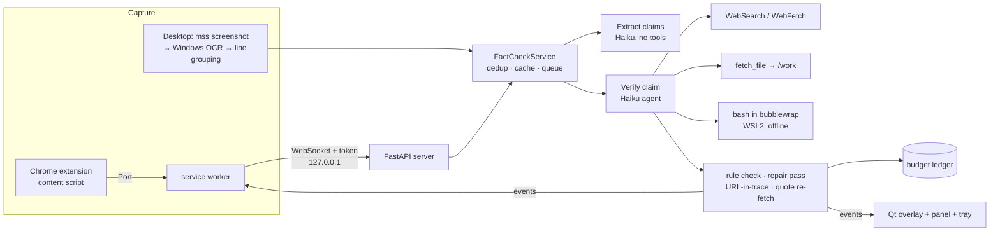

# fact-check-websites-apps

**Fact-check the claims you see — in Chrome and in any desktop app (Discord, Slack, PDFs, ...).**
A Chrome extension underlines claims inline on web pages; for everything else, Windows OCR reads the
screen and a click-through overlay boxes each claim. Every claim is checked by a
[Claude Agent SDK](https://code.claude.com/docs/en/agent-sdk/overview.md) agent running **Haiku 5.5** with web search, page fetch, an audited
file-download tool and a **sandboxed bash shell** (python/numpy/pandas/sympy, node, deno, gcc, … inside
bubblewrap in WSL2). Each verdict carries one of the four [AVeriTeC](https://arxiv.org/abs/2305.13117) labels, a **confidence score with the
reasoning for that confidence**, sources with quote checks, and — for false or cherry-picked claims — a
**sourced correction**.

| Browser (extension, real Haiku verdicts on a live page) | Desktop (overlay on a rendered chat, real Haiku verdicts) |
|---|---|
|  |  |


**Why:** misinformation reaches people wherever they read, not only on web pages. Existing tools
(e.g. [OpenErrata](https://github.com/ZeroPathAI/OpenErrata), [Loki](https://arxiv.org/abs/2410.01794)) cover the browser or a text box; none we found reads arbitrary desktop apps
with an on-screen overlay ([literature review](reports/literature-review.md)).

**Method in one line:** captured text → Haiku extracts atomic, self-contained, check-worthy claims (the
decomposition idea of [SAFE](https://arxiv.org/abs/2403.18802)) → one Haiku agent per claim gathers evidence with tools and returns a
schema-enforced verdict → our code checks the verdict rules, that cited URLs appeared in the agent's own
results, and that quotes really appear on the cited pages.

**Results:** the benchmark evaluation (AVeriTeC, CheckThat! 2024) is preregistered in
[`reports/preregistration.md`](reports/preregistration.md) before any confirmatory run; results will appear here once it has run.
Early end-to-end runs: "The Great Wall of China is visible from the Moon" → *Refuted, 93 %* with a correction;
"Everest is 8,849 m" → *Supported, 90 %*; "7 % a year doubles money in ~10 years" → *Supported, 93 %* from a
sandbox computation (ln 2 / ln 1.07 = 10.24). These are demonstrations, not evidence of accuracy.

---

## Features

* **Two capture paths**
  * Chrome/Chromium **MV3 extension**: exact page text, inline underlines via the CSS Custom Highlight API
    (no DOM edits), hover card with full verdict, auto mode / `Alt+Shift+F` / right-click "Fact-check selected text".
  * **Desktop OCR** (Windows.Media.Ocr): `Ctrl+Alt+F` checks everything on all monitors; continuous mode checks the
    foreground window when it settles. Lines are grouped into messages/paragraphs before extraction.
* **Display**: per-monitor click-through **overlay** (colour = label, border width = confidence, tag "Refuted 93 %")
  and/or a **side panel** with label, confidence + reasoning, explanation, correction, sources (✓ quote found /
  ✗ not found / not checked), sandbox computations, and a "Check this claim" button.
* **Agent tools**: built-in WebSearch + WebFetch; `fetch_file` (raw CSV/JSON/XLSX/PDF/HTML into a per-claim `/work`
  folder, public internet only, SSRF-safe); `bash` in an offline bubblewrap sandbox with every interpreter/compiler
  in WSL.
* **Cost control**: hard project budget (default $10 API-equivalent) in a committed [`budget_ledger.jsonl`](budget_ledger.jsonl),
  daily app cap, verdict cache, auto-check of only the first 3 new claims per batch, ≤ 2 web searches per claim.
* **Auth**: your Claude subscription login first; API key from `.env` only as automatic fallback.
* **Logging**: every prompt, tool call, tool output and result is written uncut to `logs/llm-*.jsonl` and the terminal.

## How it works



What happens when you run it:

1. `uv run factcheck` starts the Qt app (tray icon) and a background asyncio thread with the localhost server,
   the fact-check service and the capture loop.
2. Text arrives from the extension (visible paragraphs of the page) or from OCR (hotkey: all monitors;
   continuous: the foreground window, after two identical frames).
3. New blocks go to the **extractor** (one Haiku call, no tools) which returns atomic claims with exact spans.
4. Cached claims are answered immediately; the first 3 new ones are queued for **verification**, the rest wait
   for a click. Each verification runs in its own CLI subprocess with an isolated config, a fresh `/work` folder,
   hooks that cap searches, and a JSON schema for the verdict.
5. The verdict is validated (e.g. a "Refuted" verdict must include a correction with its own source); one cheap
   tool-less repair pass fixes rule violations; sources are checked against the tool trace and re-fetched to
   verify quotes.
6. Events flow back to the page (underline colour + hover card) or to the overlay and panel.

Details: [docs/architecture.md](docs/architecture.md) · security model: [docs/security.md](docs/security.md).

## Install

Requirements: Windows 11, [uv](https://docs.astral.sh/uv/), WSL2 with Ubuntu (for the sandbox; `bubblewrap` is
usually preinstalled — check with `wsl -e bwrap --version`), Google Chrome, and a Claude subscription logged in to
[Claude Code](https://code.claude.com/docs) (or an Anthropic API key).

```bash
git clone https://github.com/BurnyCoder/fact-check-websites-apps
cd fact-check-websites-apps
uv sync
wsl.exe -e bash scripts/setup_wsl_sandbox.sh
copy .env.example .env
```

* **Auth**: nothing to do if Claude Code is logged in with your subscription (`AUTH_MODE=auto` uses it).
  Optionally put `ANTHROPIC_API_KEY` in `.env` as a fallback. The subscription mode is meant for personal,
  single-user use; the SDK docs ask distributed products to use API keys
  ([legal](https://code.claude.com/docs/en/legal-and-compliance.md)).
* **Chrome extension**: open `chrome://extensions`, enable *Developer mode*, *Load unpacked* → select the
  `extension/` folder. Start the app, choose *Copy extension token* in the tray menu, paste it into the
  extension's *Options* page.

## Use

```bash
uv run factcheck                                  # desktop app (tray icon, overlay, panel, hotkey Ctrl+Alt+F)
uv run factcheck-cli claim "Water boils at 90 °C at sea level."
uv run factcheck-cli text "Paste a paragraph; every check-worthy claim in it is verified."
uv run factcheck-cli budget                       # API-equivalent spend so far
```

Settings live in `.env` (see [`.env.example`](.env.example)): `FACTCHECK_MODE=continuous|hotkey|both`,
`FACTCHECK_DISPLAY=overlay|panel|both`, `TOTAL_BUDGET_USD`, `DAILY_APP_BUDGET_USD`, `MAX_WEB_SEARCHES`,
`BLOCKED_APPS`, `HOTKEY`, `FACTCHECK_FAKE_LLM=true` (deterministic fake verdicts, $0, for UI work).
Tray menu: pause, check screen now, switch trigger/display modes, copy extension token, open logs, budget.

## Privacy and safety (short version)

* Screen text is sent only to Anthropic (through the Agent SDK). Logs stay local and are gitignored.
* Not captured: blocked apps (password managers by default), our own windows, incognito/private windows, and Chrome
  windows while the extension handles them. Pause any time from the tray.
* Screen text is untrusted: the agent has no access to your files or shell. Its only code execution is an
  **offline** bubblewrap sandbox in WSL2 that sees nothing but `/usr`, a read-only tools folder and the claim's own
  `/work` folder; downloads go through our SSRF-safe `fetch_file`. Escape attempts are covered by tests
  (`tests/test_sandbox.py`, `tests/test_fetchfile_policy.py`).
* Your global Claude Code configuration (CLAUDE.md, hooks, skills, MCP servers, connectors) is not loaded into the
  agent.

## Tests

```bash
uv run pytest            # 85 tests, $0: fake SDK/FakeRunner, real sandbox, real OCR, Playwright extension e2e
```

## Project layout

```
src/factcheck/
  app.py            # desktop entry point: config → logging → Qt → backend → UI
  cli.py            # factcheck-cli
  backend.py        # asyncio thread: uvicorn server + service + capture
  config.py log.py models.py
  pipeline/         # agent.py (SDK wrapper), extract.py, verify.py, prompts.py, sandbox.py, fetchfile.py,
                    # agent_tools.py, sources.py, cache.py, budget.py, service.py, policy.py, fake.py
  server/api.py     # localhost WebSocket for the extension
  capture/          # winapi.py, ocr.py, layout.py, watcher.py
  ui/               # overlay.py, panel.py, tray.py, hotkey.py, state.py
extension/          # Chrome MV3 extension (plain JS)
scripts/            # WSL sandbox setup, demo scripts
reports/            # literature review, preregistration, experiment reports, paper
tests/
```

## Technologies

Python 3.13 · [claude-agent-sdk](https://github.com/anthropics/claude-agent-sdk-python) 0.2.179 (Haiku 5.5) · PySide6 6.12 · FastAPI/uvicorn ·
[pywinrt](https://pypi.org/project/winrt-Windows.Media.Ocr/) Windows.Media.Ocr · mss · bubblewrap (WSL2) · httpx/httpcore · trafilatura · rapidfuzz · pysbd ·
Chrome MV3 + CSS Custom Highlight API · Playwright · pytest · uv.

## License

Code: MIT (see `LICENSE`). Benchmark data used in `eval/` keeps its own licence (AVeriTeC: CC-BY-NC-4.0).
