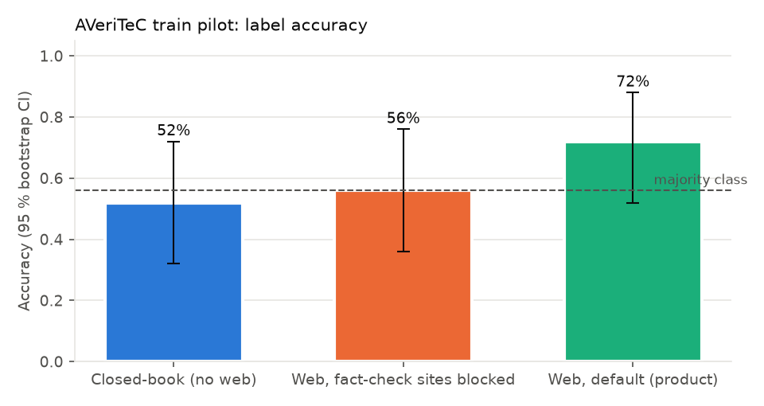

# Experiment 1 — pilot (AVeriTeC train, 25 claims × 3 arms)

Author: Libor "Burny" Burian · 2026-11-08 · Exploratory; run before the preregistration was frozen.

**Purpose.** Measure cost per claim, latency and the paired disagreement between arms, to size the confirmatory
study within the $10 project budget, and to find failure modes on data that is not used for confirmation.

**Design.** 25 claims sampled from AVeriTeC *train* (`random.Random(7)`), each verified in three arms
(`closed_book`, `web_blocked`, `web_default`; definitions in [`preregistration.md`](preregistration.md) § 3), conditions
interleaved in random order, 4 concurrent agents. Results: `results/pilot/*.jsonl`.

## Results

<!-- GEN:pilot_arms -->
| Condition | n | Accuracy [95 % CI] | Macro-F1 [95 % CI] | 3-class acc. | Brier | ECE | $/claim | p50 latency |
|---|---|---|---|---|---|---|---|---|
| Closed-book (no web) | 25 | 52.0 % [32.0, 72.0] | 57.6 % [29.3, 73.8] | 56.0 % | 0.179 | 0.194 | $0.0009 | 7 s |
| Web, fact-check sites blocked | 25 | 56.0 % [36.0, 76.0] | 38.6 % [22.0, 53.7] | 56.0 % | 0.187 | 0.197 | $0.0222 | 23 s |
| Web, default (product) | 25 | 72.0 % [52.0, 88.0] | 62.4 % [34.3, 83.3] | 72.0 % | 0.207 | 0.201 | $0.0211 | 21 s |
<!-- /GEN:pilot_arms -->

<!-- GEN:pilot_per_class -->
| Condition | F1 Supp. (n=6) | F1 Ref. (n=14) | F1 NEE (n=2) | F1 Confl. (n=3) |
|---|---|---|---|---|
| Closed-book (no web) | 0.67 | 0.57 | 0.27 | 0.80 |
| Web, fact-check sites blocked | 0.55 | 0.71 | 0.29 | 0.00 |
| Web, default (product) | 0.60 | 0.83 | 0.67 | 0.40 |
<!-- /GEN:pilot_per_class -->

## What we learned

* With n = 25 every interval is wide (±20 points); the pilot is for planning, not for conclusions.
* The two web arms and the closed-book arm disagree on about half of the claims in both directions (power analysis
  in [`preregistration.md`](preregistration.md) § 5), so detecting a small retrieval benefit (H1) needs far more claims
  than the budget allows; the preregistration states the minimum detectable effect instead of pretending otherwise.
* 3 of 75 verifications failed because Haiku omitted nullable schema fields five times in a row. Fixed before freezing
  (schema requires only core fields; failed structured output is salvaged from the collected evidence) — see
  [`exp-00-development.md`](exp-00-development.md) #8.
* The sandbox was not used in the pilot claims (none needed arithmetic); `fetch_file` was rarely used.
