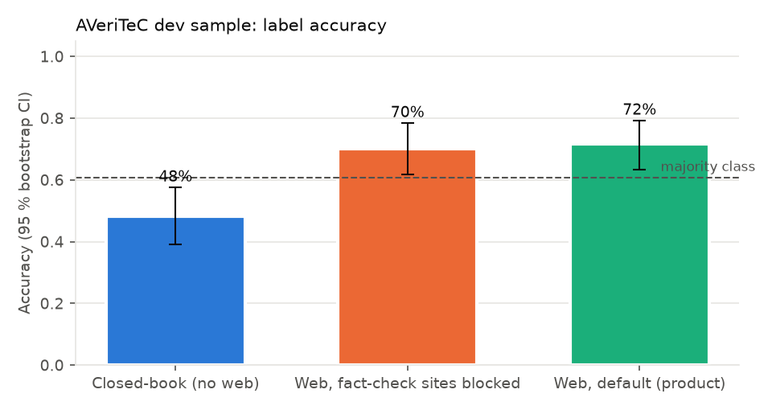
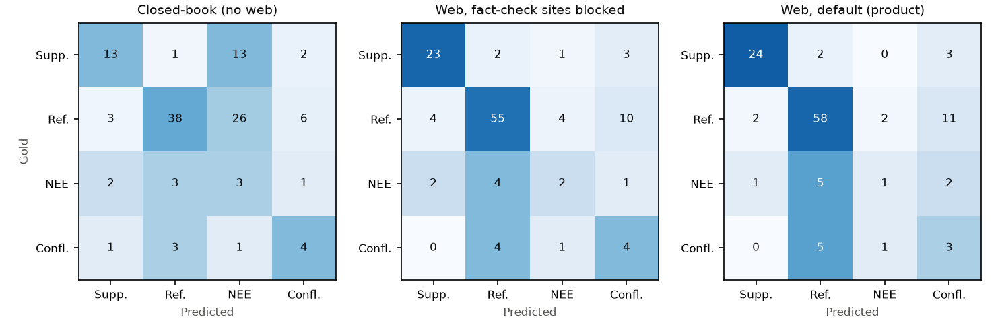
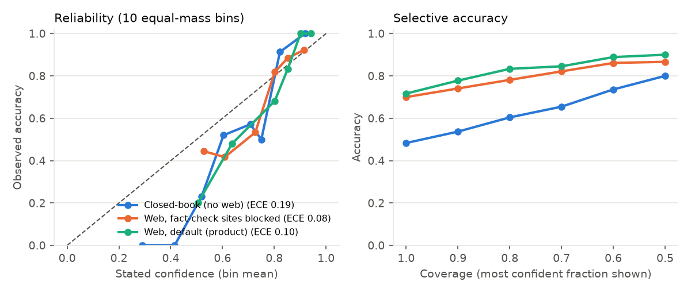

# Experiment 2 — H1 / H2: retrieval vs memory, and the value of existing fact-checks (confirmatory)

Author: Libor "Burny" Burian · 2026-11-08 · Preregistered ([`preregistration.md`](preregistration.md), tag `prereg-v1`).

**Question.** Does giving Haiku 5.5 web search, page fetch, downloads and a sandbox improve label accuracy over the
same model and prompt without web access (H1, with fact-check sites blocked so the agent cannot simply look up the
answer), and how much does access to existing online fact-checks add on top (H2)?

**Data.** 120 AVeriTeC dev claims, label-stratified (73 Refuted, 29 Supported, 9 Conflicting/Cherry-picking, 9 Not
Enough Evidence; `results/samples/dev_web_sample.json`). **Arms.** `closed_book` (sandboxed bash only),
`web_blocked` (web tools; leakage block + 57 fact-check publishers and fact-check URL paths blocked), `web_default`
(web tools; leakage block only). Each claim × arm is one fresh agent session (no cache), conditions interleaved.
**Primary metric.** 4-class accuracy; one-sided exact McNemar test; Holm correction over H1, H2, H4.

## Results

<!-- GEN:confirmatory_arms -->
| Condition | n | Accuracy [95 % CI] | Macro-F1 [95 % CI] | 3-class acc. | Brier | ECE | $/claim | p50 latency |
|---|---|---|---|---|---|---|---|---|
| Closed-book (no web) | 120 | 48.3 % [39.2, 57.5] | 41.6 % [31.6, 50.8] | 50.0 % | 0.173 | 0.190 | $0.0007 | 8 s |
| Web, fact-check sites blocked | 120 | 70.0 % [61.7, 78.3] | 53.0 % [42.6, 63.2] | 71.7 % | 0.181 | 0.081 | $0.0200 | 20 s |
| Web, default (product) | 120 | 71.7 % [63.3, 79.2] | 50.9 % [42.1, 60.5] | 74.2 % | 0.157 | 0.104 | $0.0187 | 20 s |
<!-- /GEN:confirmatory_arms -->

<!-- GEN:h12_tests -->
| Hypothesis | Comparison | n | Accuracy diff (pts) [95 % CI] | Macro-F1 diff (pts) [95 % CI] | A-only / B-only | p (one-sided) | p (Holm) | Decision |
|---|---|---|---|---|---|---|---|---|
| H1 | web, fact-checks blocked − closed-book | 120 | +21.7 [+11.7, +30.8] | +11.4 [-0.4, +23.1] | 33 / 7 | < 0.001 | < 0.001 | **supported** |
| H2 | web default − web, fact-checks blocked | 120 | +1.7 [-5.8, +9.2] | -2.1 [-13.8, +10.6] | 11 / 9 | 0.412 | 0.412 | not supported (inconclusive at this sample size) |
<!-- /GEN:h12_tests -->

### Per-class F1

<!-- GEN:confirmatory_per_class -->
| Condition | F1 Supp. (n=29) | F1 Ref. (n=73) | F1 NEE (n=9) | F1 Confl. (n=9) |
|---|---|---|---|---|
| Closed-book (no web) | 0.54 | 0.64 | 0.12 | 0.36 |
| Web, fact-check sites blocked | 0.79 | 0.80 | 0.24 | 0.30 |
| Web, default (product) | 0.86 | 0.81 | 0.15 | 0.21 |
<!-- /GEN:confirmatory_per_class -->

### Leakage audit and sensitivity analysis

<!-- GEN:audit -->
| Web arm | n | benchmark name seen | fact-check title/URL seen | blocked domain seen |
|---|---|---|---|---|
| Web, fact-check sites blocked | 120 | 0.0 % | 46.7 % | 0.8 % |
| Web, default (product) | 120 | 0.0 % | 64.2 % | (not blocked) |
<!-- /GEN:audit -->

<!-- GEN:sensitivity -->
Claims flagged by the leakage audit in either web arm: **82**. Re-running the paired tests without them:

| Hypothesis | n | Accuracy diff (pts) [95 % CI] | p (one-sided, uncorrected) |
|---|---|---|---|
| H1 | 38 | +10.5 [-5.3, +26.3] | 0.172 |
| H2 | 38 | +5.3 [-10.5, +21.1] | 0.363 |

*Exploratory (not preregistered):* H1 excluding only the 57 claims flagged in the blocked arm: n = 63, +19.0 pts [+6.3, +31.7], one-sided p = 0.004. The excluded claims are not a random subset (claims with published fact-checks are the better-known ones), so neither restricted estimate is an unbiased estimate for new claims.
<!-- /GEN:sensitivity -->

### Calibration of the stated confidence

<!-- GEN:calibration -->
| Condition | Mean stated confidence | Accuracy | Brier | ECE (10 equal-mass bins) | Accuracy of the 50 % most confident |
|---|---|---|---|---|---|
| Closed-book (no web) | 62.2 % | 48.3 % | 0.173 | 0.190 | 80.0 % |
| Web, fact-check sites blocked | 75.6 % | 70.0 % | 0.181 | 0.081 | 86.7 % |
| Web, default (product) | 78.5 % | 71.7 % | 0.157 | 0.104 | 90.0 % |
<!-- /GEN:calibration -->

### Secondary metrics

<!-- GEN:secondary -->
| Condition | 3-class acc. | Supported-vs-Refuted acc. (n) | Predicted S / R / NEE / C | Searches/claim | Sources/claim | Source URL in agent's results | Quotes checkable | Quotes verified (of checkable) | Sandbox used | p95 latency | Failed checks |
|---|---|---|---|---|---|---|---|---|---|---|---|
| Closed-book (no web) | 50.0 % | 50.0 % (102) | 19 / 45 / 43 / 13 | 0.00 | 0.12 | 100.0 % | 0.0 % | 0.0 % | 0.0 % | 12 s | 1 |
| Web, fact-check sites blocked | 71.7 % | 76.5 % (102) | 29 / 65 / 8 / 18 | 1.48 | 2.59 | 99.7 % | 63.7 % | 68.7 % | 0.8 % | 38 s | 4 |
| Web, default (product) | 74.2 % | 80.4 % (102) | 27 / 70 / 4 / 19 | 1.32 | 2.64 | 99.1 % | 85.8 % | 62.5 % | 2.5 % | 36 s | 5 |
<!-- /GEN:secondary -->

## Interpretation

* **H1 is supported.** With every fact-checking publisher blocked, web tools still lifted accuracy far above the
  closed-book arm (tables above). Almost all of the gain is on Supported and Refuted claims; without the web the model
  hedged, predicting *Not Enough Evidence* for a large share of claims although only 9 of the 120 carry that label, which
  puts closed-book accuracy *below* the majority-class baseline. With the web, the agent commits to a label and beats
  the majority baseline.
* **H2 is inconclusive, not "no effect".** Allowing fact-check sites changed accuracy by a small amount with a wide
  interval; the study could only detect differences of about 13.5 points (preregistration § 5). One reason the two web
  arms are close: the audit shows the blocked arm still saw fact-check-titled results from *unblocked* outlets
  (syndicated or re-reported fact-checks) for close to half of the claims, so the contrast between the arms is weaker
  than the blocklists suggest.
* **Leakage.** The domain blocklists held (blocked-domain hits are near zero and no copy of the benchmark was ever
  seen), but fact-check content is hard to remove from a live web index. The preregistered sensitivity analysis (all
  claims flagged in either arm removed) keeps too few claims to conclude anything and is not a random subset. The
  exploratory version that removes only the claims flagged in the blocked arm still shows a clear retrieval benefit.
  Our reading: retrieval helps on its own, but part of the headline gain on these well-known 2020–2022 claims comes
  from reaching other people's fact-checks, and the size of the benefit for genuinely new claims is uncertain.
* **Rare labels stay hard.** Per-class F1 for *Not Enough Evidence* and *Conflicting/Cherry-picking* is low in every
  arm and rests on 9 claims each, consistent with earlier AVeriTeC systems.
* **Confidence is informative but optimistic.** All arms state higher confidence than their accuracy (overconfidence,
  as reported for verbalised confidence by [Xiong et al. 2024](https://arxiv.org/abs/2306.13063)), yet the most confident half of the product
  arm's verdicts is markedly more accurate than the rest, so ranking or hiding low-confidence verdicts is useful.
* **Sources.** Nearly every cited URL appeared in the agent's own tool results; a sizeable share of quotes could not be
  checked (sites blocking automated fetches) and of the checkable ones roughly a third did not appear verbatim on the
  page (paraphrases, typically from WebFetch summaries) — the per-source badges in the UI exist for this reason.
* **Cost and speed** per claim are in the first table; the sandbox was rarely needed for these claims.
* **Note on the sandbox fix.** The runs predate the seccomp hardening of the sandbox (code review, see
  [`docs/security.md`](../docs/security.md)); the fix does not change verification behaviour.
