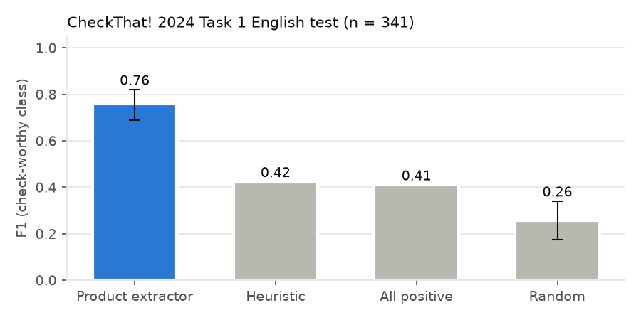

# Experiment 4 — H4: does the extractor find check-worthy sentences? (confirmatory)

Author: Libor "Burny" Burian · 2026-11-08 · Preregistered.

**Question.** The app only verifies what the extractor picks out. How well does the zero-shot extractor identify
check-worthy sentences compared with simple baselines?

**Data.** CLEF CheckThat! 2024 Task 1 English test set: 341 sentences from US presidential debates with released gold
labels ([task](https://checkthat.gitlab.io/clef2024/task1)). **Method.** Sentences in batches of 15 (context: "US
presidential debate transcript"); a sentence counts as check-worthy if the extractor returns at least one claim whose
span lies in it. No training and no prompt tuning on the test set (prompt checked on the dev split only).
**Baselines.** All-positive; stratified random (1,000 seeded draws); a heuristic that marks sentences containing a
number or a quantity/comparison word (`eval/report.py::heuristic_checkworthy`). **Test.** One-sided approximate
randomisation (10,000 swaps) vs the better of all-positive and heuristic; Holm correction with H1 and H2.

## Results

<!-- GEN:h4_table -->
| System | F1 (check-worthy) | Precision | Recall |
|---|---|---|---|
| Product extractor (Haiku, zero-shot) | 0.759 [0.689, 0.820] | 0.670 | 0.875 |
| Number/quantity-word heuristic | 0.424 | – | – |
| All positive | 0.410 | 0.258 | 1.000 |
| Stratified random (1,000 draws) | 0.256 [0.175, 0.340] | – | – |

Permutation test vs the best baseline (heuristic, F1 0.424): p < 0.001, Holm-adjusted p < 0.001 → **supported**. For reference, published fine-tuned systems reached F1 ≈ 0.75–0.80 on this test set (e.g. RoBERTa 0.753, [IAI 2024](https://arxiv.org/abs/2408.01118)).
<!-- /GEN:h4_table -->

## Interpretation

* **H4 is supported.** The zero-shot extractor finds check-worthy debate sentences far better than the simple baselines
  and lands in the range that fine-tuned systems reached on the same test set — without any training data.
* **High recall, moderate precision.** The extractor rarely misses a check-worthy sentence but flags about one in three
  sentences that annotators did not consider check-worthy. For the app this means few missed claims at the price of some
  extra verifications (bounded by the auto-check limit and the budget caps).
* The comparison with published systems is indicative only: their training data, tuning and decision thresholds differ,
  and debate transcripts are not the chat or web text the app mostly sees.
