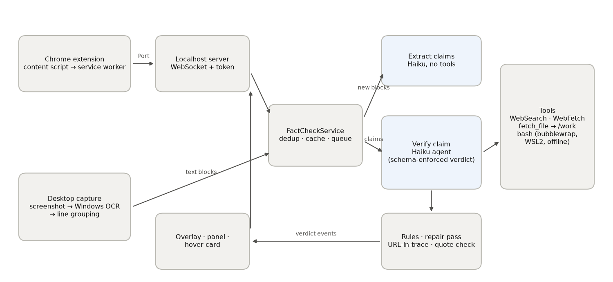
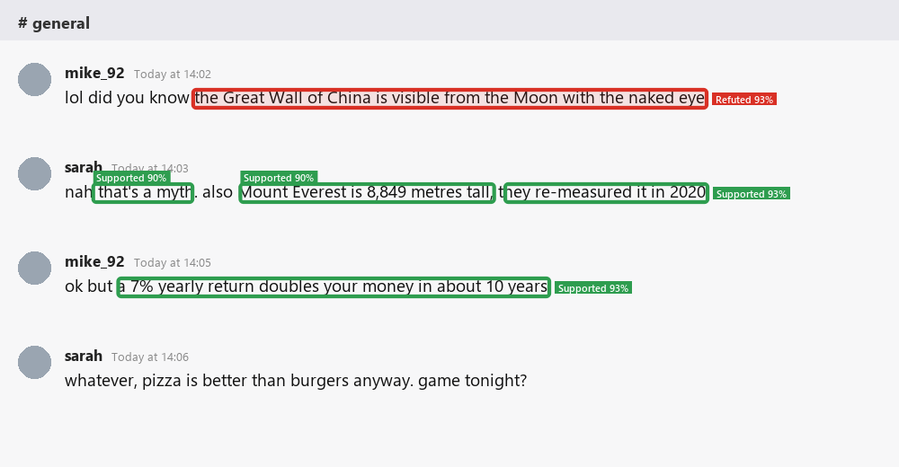
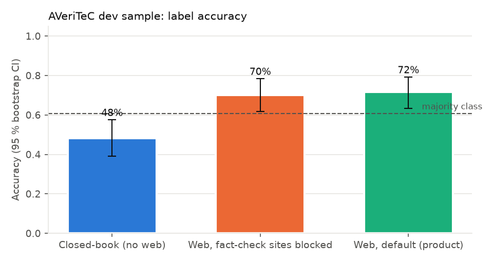
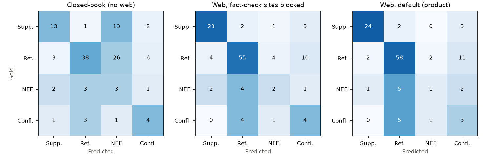
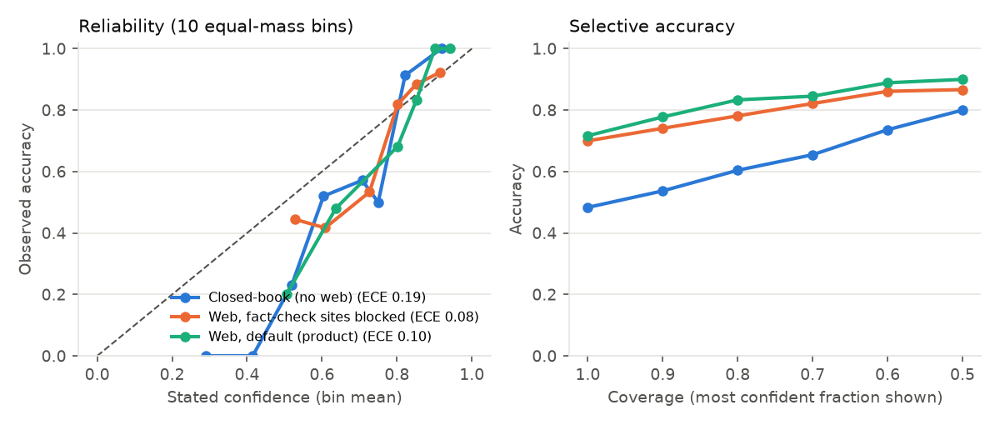
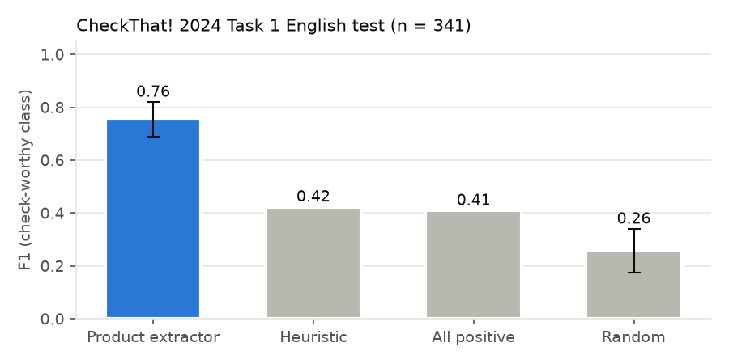

# Abstract

People meet factual claims everywhere on their screens, not only on web pages. We present an open-source Windows
application that extracts check-worthy claims from Chrome pages (via an extension) and from any desktop app (via
Windows OCR), and verifies each claim with a Claude Haiku 5.5 agent that can search the web, fetch pages, download
raw data into an isolated workspace and run code in an offline bubblewrap sandbox. Every verdict carries one of the
four AVeriTeC labels, a stated confidence with the reasoning for it, sources whose quotes are re-checked against the
live page, and a sourced correction for false or cherry-picked claims. We preregistered four hypotheses and evaluated
them under a hard $10 API-equivalent budget.
<!-- GEN:abstract_numbers -->
On 120 preregistered AVeriTeC dev claims, accuracy was 48.3 % without web access, 70.0 % with web tools but all fact-checking sites blocked, and 71.7 % with the product's default web access (majority-class baseline 60.8 %). The retrieval effect with fact-checks blocked (H1) was +21.7 points (95 % CI +11.7 to +30.8; Holm p < 0.001) and the added effect of reaching existing fact-checks (H2) was +1.7 points (95 % CI -5.8 to +9.2; Holm p = 0.412). Reading claims from rendered pages through Windows OCR changed end-to-end accuracy by +0.8 points on 500 claims (one-sided 95 % lower bound -2.0; preregistered non-inferiority margin −3). The zero-shot claim extractor reached F1 0.759 on CheckThat! 2024 check-worthiness (best simple baseline 0.424).
<!-- /GEN:abstract_numbers -->
Code, per-claim results and an interactive explorer are public.

# 1 Introduction

Automated fact-checking systems usually take a claim as input ([Guo et al. 2022 survey](https://aclanthology.org/2022.tacl-1.11/)) or work inside one
surface such as a browser ([OpenErrata](https://github.com/ZeroPathAI/OpenErrata)). Users, however, read claims in chat apps, PDFs and feeds as well. We ask
three practical questions for a system that checks *whatever is on screen*: (i) do web tools make a small LLM agent
more accurate than its own memory, once the easy route of finding an existing fact-check is closed? (ii) how much does
that easy route contribute — important both for interpreting benchmark numbers and for users, since real claims often
*have* been fact-checked? (iii) does reading text from pixels (OCR) cost accuracy? A fourth question checks the
component that decides *what* to verify: (iv) does the zero-shot claim extractor find the sentences professional
fact-checkers consider check-worthy?

**Contributions.** (1) An open-source application (Chrome extension + Windows OCR overlay) with a tool-using verifier,
sandboxed code execution and quote-checked sources. (2) A preregistered evaluation with leakage controls, an audit,
calibration analysis and a measurement of the OCR capture channel. (3) A transparent cost model: every call is in a
committed ledger.

# 2 Related work

**Claim verification pipelines.** Loki ([Li et al. 2024](https://arxiv.org/abs/2410.01794)) decomposes text into claims, filters check-worthy ones, generates
queries, retrieves evidence and verifies; SAFE ([Wei et al. 2024](https://arxiv.org/abs/2403.18802)) splits long-form text into atomic facts and checks each
with multi-step search; FacTool and FActScore are evaluated in Factcheck-Bench ([Wang et al. 2024](https://arxiv.org/abs/2311.09000)), where the best
system reached F1 0.63 on detecting false claims. Our pipeline follows the decompose → verify structure and merges
query, retrieval and verification into one tool-using agent.

**Benchmarks.** AVeriTeC ([Schlichtkrull et al. 2023](https://arxiv.org/abs/2305.13117)) provides real-world claims with four labels and question–answer evidence;
the 2024 shared task was won with proprietary LLMs and the 2025 edition required open-weight models on one GPU
([Schlichtkrull et al. 2024](https://arxiv.org/abs/2410.23850); [FEVER-8](https://aclanthology.org/2025.fever-1.15)). The official score also evaluates retrieved evidence; we report label accuracy only.
CheckThat! 2024 Task 1 ([task](https://checkthat.gitlab.io/clef2024/task1)) evaluates check-worthiness; fine-tuned encoders reached F1 ≈ 0.75–0.80 on the English
test set (e.g. RoBERTa 0.753, [IAI 2024](https://arxiv.org/abs/2408.01118)).

**Confidence.** Verbalised confidence from RLHF models can be better calibrated than token probabilities
([Tian et al. 2023](https://arxiv.org/abs/2305.14975)) but tends to be overconfident ([Xiong et al. 2024](https://arxiv.org/abs/2306.13063)); we measure Brier score, ECE ([Guo et al. 2017](https://arxiv.org/abs/1706.04599))
and selective accuracy.

**Screen reading and sandboxing.** Screen-recording assistants such as screenpipe read text through accessibility APIs
with OCR fallback ([screenpipe](https://screenpi.pe/about)). Claude Code isolates code with bubblewrap on Linux/WSL2 ([docs](https://code.claude.com/docs/en/sandboxing)); we adopt the same
mechanism with an explicit mount allow-list because the agent processes untrusted screen text.

# 3 System

{width=95%}

**Capture.** The extension's content script collects visible text blocks (nearest block-level ancestor of each text
node) and sends new ones over a runtime port to the service worker, which holds one authenticated WebSocket to a
127.0.0.1 server. The desktop path screenshots monitors (hotkey) or the foreground window when two consecutive frames
match (continuous), runs Windows.Media.Ocr, merges same-row lines and groups lines into messages/paragraphs.

**Extraction.** One tool-less Haiku call per batch returns atomic, self-contained, check-worthy claims with an exact
span; spans are re-aligned to the source text (exact, then fuzzy) so they can be highlighted.

**Verification.** One isolated agent session per claim (Claude Agent SDK 0.2.179; user settings, CLAUDE.md, memory and
connectors disabled) with WebSearch (≤ 2 calls, enforced by a PreToolUse hook), WebFetch (≤ 3), `fetch_file`
(public-internet-only downloads with connect-time IP vetting) and `bash` in an offline bubblewrap sandbox in WSL2 that
sees only `/usr`, a read-only tool folder and a per-claim `/work`. The verdict (label, confidence, confidence reasoning,
explanation, corrected claim with its own confidence and reasoning, sources, computations) is JSON-schema-enforced;
rules the schema cannot express (e.g. a correction needs its own source) trigger one tool-less repair pass. Cited URLs
are checked against the agent's tool trace, and quotes are re-fetched and fuzzy-matched on the live page.

**Display.** Highlights via the CSS Custom Highlight API and a hover card in Chrome; per-monitor click-through overlay
windows (excluded from screen capture) and a side panel on the desktop.

{width=80%}

# 4 Evaluation method

The full protocol is in the preregistration (git tag `prereg-v1`), frozen before any confirmatory run.

* **Data.** AVeriTeC dev (500 claims; used as held-out test); a label-stratified sample of 120 for the web arms;
  CheckThat! 2024 Task 1 English test (341 sentences).
* **Arms.** `closed_book` (sandbox only); `web_blocked` (web tools; dataset mirrors, 57 fact-check publishers and
  fact-check URL paths blocked, enforced on search, fetch and downloads); `web_default` (dataset mirrors blocked only).
  H3 renders each claim in a generic chat or article page (2 layouts × 3 font sizes), reads it with Windows OCR and
  compares with ideal text; both arms extract and verify closed-book.
* **Tests.** Accuracy (primary); one-sided exact McNemar for H1/H2; non-inferiority with margin 3 points for H3 (paired
  bootstrap); approximate randomisation vs the best simple baseline for H4; Holm correction over H1, H2, H4.
* **Leakage audit.** Each web-arm claim is flagged if its tool results mention the benchmark, contain a fact-check
  title/URL, or (blocked arm) a blocked domain; H1/H2 are re-run without flagged claims.
* **Budget and power.** A 25-claim pilot on AVeriTeC train fixed n = 120 within the budget; minimum detectable effects
  were 17.5 (H1) and 13.5 (H2) accuracy points at 80 % power.

# 5 Results

## 5.1 Method, baselines, controls and ablations

<!-- GEN:eval_table -->
| Role | System | Benchmark | Metric | Score |
|---|---|---|---|---|
| Baseline | Always 'Refuted' (majority class) | AVeriTeC dev sample (n = 120) | accuracy | 60.8 % |
| Baseline | Uniform random label | AVeriTeC dev sample | accuracy | 25.0 % (expected) |
| Control (no retrieval) | Closed-book (no web) | AVeriTeC dev sample | accuracy / macro-F1 | 48.3 % / 41.6 % |
| Ablation (no fact-check sites) | Web, fact-check sites blocked | AVeriTeC dev sample | accuracy / macro-F1 | 70.0 % / 53.0 % |
| **Method (product)** | Web, default (product) | AVeriTeC dev sample | accuracy / macro-F1 | 71.7 % / 50.9 % |
| Control (ideal capture) | Clean text → extract → closed-book verify | AVeriTeC dev (n = 500) | accuracy | 49.0 % |
| **Method (screen path)** | Rendered → OCR → extract → closed-book verify | AVeriTeC dev (n = 500) | accuracy | 49.8 % |
| **Method** | Product extractor | CheckThat! 2024 T1 EN test (n = 341) | F1 | 0.759 |
| Baseline | Number/quantity heuristic | CheckThat! 2024 T1 EN test | F1 | 0.424 |
| Baseline | All positive | CheckThat! 2024 T1 EN test | F1 | 0.410 |
| Control | Stratified random | CheckThat! 2024 T1 EN test | F1 | 0.256 |
<!-- /GEN:eval_table -->

## 5.2 H1 and H2: retrieval and existing fact-checks

<!-- GEN:confirmatory_arms -->
| Condition | n | Accuracy [95 % CI] | Macro-F1 [95 % CI] | 3-class acc. | Brier | ECE | $/claim | p50 latency |
|---|---|---|---|---|---|---|---|---|
| Closed-book (no web) | 120 | 48.3 % [39.2, 57.5] | 41.6 % [31.6, 50.8] | 50.0 % | 0.173 | 0.190 | $0.0007 | 8 s |
| Web, fact-check sites blocked | 120 | 70.0 % [61.7, 78.3] | 53.0 % [42.6, 63.2] | 71.7 % | 0.181 | 0.081 | $0.0200 | 20 s |
| Web, default (product) | 120 | 71.7 % [63.3, 79.2] | 50.9 % [42.1, 60.5] | 74.2 % | 0.157 | 0.104 | $0.0187 | 20 s |
<!-- /GEN:confirmatory_arms -->

<!-- GEN:h12_tests -->
| Hypothesis | Comparison | n | Accuracy diff (pts) [95 % CI] | Macro-F1 diff (pts) [95 % CI] | A-only / B-only | p (one-sided) | p (Holm) | Decision |
|---|---|---|---|---|---|---|---|---|
| H1 | web, fact-checks blocked − closed-book | 120 | +21.7 [+11.7, +30.8] | +11.4 [-0.4, +23.1] | 33 / 7 | < 0.001 | < 0.001 | **supported** |
| H2 | web default − web, fact-checks blocked | 120 | +1.7 [-5.8, +9.2] | -2.1 [-13.8, +10.6] | 11 / 9 | 0.412 | 0.412 | not supported (inconclusive at this sample size) |
<!-- /GEN:h12_tests -->

{width=75%}

{width=100%}

**Leakage audit.**

<!-- GEN:audit -->
| Web arm | n | benchmark name seen | fact-check title/URL seen | blocked domain seen |
|---|---|---|---|---|
| Web, fact-check sites blocked | 120 | 0.0 % | 46.7 % | 0.8 % |
| Web, default (product) | 120 | 0.0 % | 64.2 % | (not blocked) |
<!-- /GEN:audit -->

<!-- GEN:sensitivity -->
Claims flagged by the leakage audit in either web arm: **82**. Re-running the paired tests without them:

| Hypothesis | n | Accuracy diff (pts) [95 % CI] | p (one-sided, uncorrected) |
|---|---|---|---|
| H1 | 38 | +10.5 [-5.3, +26.3] | 0.172 |
| H2 | 38 | +5.3 [-10.5, +21.1] | 0.363 |

*Exploratory (not preregistered):* H1 excluding only the 57 claims flagged in the blocked arm: n = 63, +19.0 pts [+6.3, +31.7], one-sided p = 0.004. The excluded claims are not a random subset (claims with published fact-checks are the better-known ones), so neither restricted estimate is an unbiased estimate for new claims.
<!-- /GEN:sensitivity -->

## 5.3 Calibration

<!-- GEN:calibration -->
| Condition | Mean stated confidence | Accuracy | Brier | ECE (10 equal-mass bins) | Accuracy of the 50 % most confident |
|---|---|---|---|---|---|
| Closed-book (no web) | 62.2 % | 48.3 % | 0.173 | 0.190 | 80.0 % |
| Web, fact-check sites blocked | 75.6 % | 70.0 % | 0.181 | 0.081 | 86.7 % |
| Web, default (product) | 78.5 % | 71.7 % | 0.157 | 0.104 | 90.0 % |
<!-- /GEN:calibration -->

{width=95%}

## 5.4 H3: the OCR capture channel

<!-- GEN:h3_table -->
| Arm | n | Accuracy | Extraction failed | Mean CER | Mean WER |
|---|---|---|---|---|---|
| Clean text | 500 | 49.0 % | 0.4 % | 0.00 % | 0.00 % |
| Rendered → OCR | 500 | 49.8 % | 0.4 % | 1.09 % | 4.01 % |

Difference OCR − clean: **+0.8 pts** (95 % CI [-2.4, +4.0]); one-sided 95 % lower bound **-2.0 pts** vs the preregistered margin −3.0 → **non-inferior** (H3 supported). Discordant pairs: OCR-only right 37, clean-only right 33.

| OCR cell | n | Accuracy | Mean CER |
|---|---|---|---|
| chat-13px | 84 | 38.1 % | 1.33 % |
| chat-15px | 84 | 46.4 % | 0.41 % |
| chat-18px | 83 | 55.4 % | 0.44 % |
| article-13px | 83 | 53.0 % | 2.14 % |
| article-15px | 83 | 51.8 % | 1.45 % |
| article-18px | 83 | 54.2 % | 0.76 % |
<!-- /GEN:h3_table -->

## 5.5 H4: check-worthiness

<!-- GEN:h4_table -->
| System | F1 (check-worthy) | Precision | Recall |
|---|---|---|---|
| Product extractor (Haiku, zero-shot) | 0.759 [0.689, 0.820] | 0.670 | 0.875 |
| Number/quantity-word heuristic | 0.424 | – | – |
| All positive | 0.410 | 0.258 | 1.000 |
| Stratified random (1,000 draws) | 0.256 [0.175, 0.340] | – | – |

Permutation test vs the best baseline (heuristic, F1 0.424): p < 0.001, Holm-adjusted p < 0.001 → **supported**. For reference, published fine-tuned systems reached F1 ≈ 0.75–0.80 on this test set (e.g. RoBERTa 0.753, [IAI 2024](https://arxiv.org/abs/2408.01118)).
<!-- /GEN:h4_table -->

{width=65%}

## 5.6 Exploratory: run-to-run variance (E2) and corrections (E3)

<!-- GEN:e2_table -->
Closed-book verifier run 3 times on the first 100 sampled claims: Fleiss' κ = **0.685**, identical label in all 3 runs for 68.0 % of claims, accuracy per run 51.0 %, 52.0 %, 50.0 % (SD 1.0 pts).
<!-- /GEN:e2_table -->

<!-- GEN:e3_table -->
| Judge verdict | Count | Share |
|---|---|---|
| agrees | 45 | 51.7 % |
| partially | 33 | 37.9 % |
| gold_supports_claim | 6 | 6.9 % |
| disagrees | 3 | 3.4 % |

87 corrections judged (web default arm, predicted Refuted or Conflicting). Correction sources whose quote could be checked on the live page: 89, of which verified 60.7 %.
<!-- /GEN:e3_table -->

# 6 Discussion

**Retrieval matters, and so does where the evidence comes from.** Giving a small model web search, page reading,
downloads and a sandbox turned a hedging closed-book model — which predicted *Not Enough Evidence* far more often than
the gold labels warrant and fell below the majority-class baseline — into one that commits to labels and clearly beats
that baseline, even with every known fact-checking publisher blocked (H1, Table in § 5.2). The size of that benefit for
genuinely new claims is less certain than the headline suggests: fact-check content reaches a live web index through
many unblocked outlets, and the agent saw such content for close to half of the claims despite the blocklists. The
preregistered sensitivity analysis (removing claims flagged in either arm) is inconclusive on the small, non-random
subset that remains, while the exploratory analysis removing only blocked-arm flags still shows a clear retrieval
benefit. We therefore read H1 as "retrieval helps" with an effect size that likely overstates performance on unseen
claims. H2 — the extra value of reaching the fact-check publishers themselves — was small and inconclusive at this
sample size; part of the reason is that the blocked arm already reached much of the same information indirectly.

**Benchmark hygiene for agents with live web access.** Our audit suggests that domain blocklists, the usual leakage
control, are necessary but not sufficient for agents that search the open web: syndicated and re-reported fact-checks
remain. Auditing what the agent actually saw, and reporting results with and without flagged items, is cheap and
should be standard.

**The screen is not the bottleneck.** On clean renders, OCR errors around one character in a hundred did not reduce
end-to-end accuracy (H3), and the extractor matched fine-tuned check-worthiness systems without training (H4). The
weakest cell — small chat fonts — points to where real-screen capture will need care.

**Confidence and corrections.** Stated confidence was optimistic but informative: the most confident half of verdicts
is markedly more accurate, so a UI can sort, dim or hide low-confidence verdicts. Corrections were mostly consistent
with professional findings according to a (conservative, by hand check) LLM judge.

**Practicality.** A verified claim cost about two cents of API-equivalent usage and about 20 seconds; with a
three-claim auto-check limit and a daily cap this is workable for personal use on a subscription.

# 7 Limitations

* **Sample size.** The $10 budget limited the web arms to 120 claims; effects below the minimum detectable effect
  (13.5–17.5 points) are inconclusive, and per-class results for the two rare labels rest on 9 claims each.
* **Memorisation.** AVeriTeC claims date from 2020–2022 and Haiku 5.5's training data extends to mid-2026; the
  closed-book arm measures memorised knowledge, which makes H1 a conservative test of retrieval and inflates absolute
  accuracy compared with genuinely new claims.
* **Leakage.** Blocking 57 fact-check publishers removes their ordinary news too; syndicated copies of fact-checks on
  other sites can still appear in search results (the audit quantifies this).
* **Metric.** Label accuracy is not comparable with the official AVeriTeC score, which also scores evidence.
* **OCR proxy.** H3 used clean, headless-rendered pages, not screenshots of real apps (screen access was not granted);
  real screens add clutter, overlapping windows and unusual fonts, so H3 is an optimistic estimate of the capture
  channel.
* **Judging.** E3 uses a model from the same family as the system under test.
* **Non-determinism.** No temperature or seed control; E2 quantifies run-to-run variance.
* **Quote checks.** Many sites block automated fetches (HTTP 401/403), so a share of quotes cannot be checked.

# 8 Conclusion

We built and evaluated an application that fact-checks what a user sees in Chrome and in desktop apps with a
tool-using Claude Haiku 5.5 agent. In a preregistered evaluation under a $10 budget, web retrieval substantially
improved label accuracy over the model's memory even with fact-check publishers blocked, though leakage through
unblocked outlets means the benefit on genuinely new claims is uncertain; access to the fact-check publishers
themselves added little detectable accuracy; reading text through Windows OCR was non-inferior to exact text; and the
zero-shot claim extractor matched fine-tuned check-worthiness systems. Future work: real-screen captures (with consent),
accessibility-API text capture, larger samples for the rare labels, claims newer than the model's training data, and
confidence recalibration.

# Spend

<!-- GEN:budget -->
| Phase | API-equivalent USD |
|---|---|
| app & demos | $1.95 |
| development & tests | $0.24 |
| evaluation | $6.15 |
| pilot | $1.11 |
| **total** | **$9.44** of $20.00 (the evaluation ran under the earlier $10.00 cap) |

3081 model calls; billed via subscription for $9.44.
<!-- /GEN:budget -->

# References

* Schlichtkrull, M. et al. (2024). The Automated Verification of Textual Claims (AVeriTeC) Shared Task. <https://arxiv.org/abs/2410.23850>
* Dror, R. et al. (2018). The Hitchhiker's Guide to Testing Statistical Significance in Natural Language Processing. ACL. <https://aclanthology.org/P18-1128/>
* Guo, C. et al. (2017). On Calibration of Modern Neural Networks. ICML. <https://arxiv.org/abs/1706.04599>
* Guo, Z., Schlichtkrull, M., Vlachos, A. (2022). A Survey on Automated Fact-Checking. TACL. <https://aclanthology.org/2022.tacl-1.11/>
* Li, H. et al. (2024). Loki: An Open-Source Tool for Fact Verification. <https://arxiv.org/abs/2410.01794>
* Schlichtkrull, M., Guo, Z., Vlachos, A. (2023). AVeriTeC: A Dataset for Real-world Claim Verification with Evidence from the Web. NeurIPS Datasets and Benchmarks. <https://arxiv.org/abs/2305.13117>
* Tian, K. et al. (2023). Just Ask for Calibration. EMNLP. <https://arxiv.org/abs/2305.14975>
* Wang, Y. et al. (2024). Factcheck-Bench: Fine-Grained Evaluation Benchmark for Automatic Fact-checkers. Findings of EMNLP. <https://arxiv.org/abs/2311.09000>
* Wei, J. et al. (2024). Long-form factuality in large language models. NeurIPS. <https://arxiv.org/abs/2403.18802>
* Xiong, M. et al. (2024). Can LLMs Express Their Uncertainty? ICLR. <https://arxiv.org/abs/2306.13063>
* CLEF CheckThat! 2024 Task 1. <https://checkthat.gitlab.io/clef2024/task1>; IAI group (2024) <https://arxiv.org/abs/2408.01118>
* Claude Agent SDK documentation. <https://code.claude.com/docs/en/agent-sdk/overview.md>; Claude Code sandboxing <https://code.claude.com/docs/en/sandboxing>
* Anthropic pricing. <https://platform.claude.com/docs/en/about-claude/pricing>

# AI statement

This codebase and paper were written by Claude Code (an AI coding agent by Anthropic, model Claude Opus 5.5) executing
an exact specification provided by the human author, who chose the research questions, constraints (tools, model,
authentication, budget, scope) and approved the plan. Human cleanup and rewriting are in progress.
